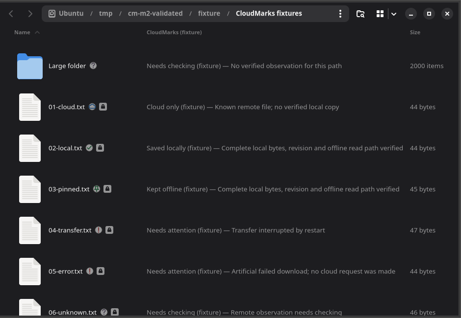
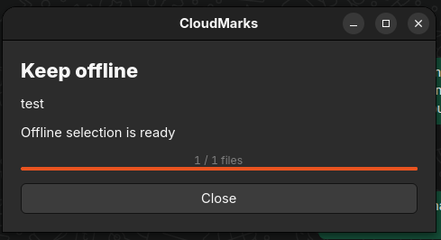

# CloudMarks

**OneDrive status badges and offline controls for GNOME Files (Nautilus).**

See which files are cloud-only, uploading, or verified for offline use directly
in your file manager. Choose **Keep offline** or **Free local copy** from the
context menu for a file or folder.

[](https://github.com/dzuritaa/cloudmarks/actions/workflows/ci.yml)
[MIT license](LICENSE) · [User guide](docs/user-guide.md) · [Report an issue](https://github.com/dzuritaa/cloudmarks/issues)

**Status: experimental alpha.** Personal acceptance tests for the dedicated
OneDrive test-account trial have passed. Broader everyday use with important
files is still being validated.

This project was **vibe-coded with AI assistance using Codex**. Code review,
reproducible bug reports, and feedback from Linux users are welcome.

## What it looks like



*Badge and column presentation in an isolated fixture demo. The files and states
in this screenshot are artificial; it illustrates the UI, not a live sync run.*



*The current progress window after a real OneDrive test-account folder was kept offline.*

## What works on main

- **Nautilus badges and a status column** for cloud, local, offline, transfer,
  partial-folder, and error states.
- **Upload observation** through a separately configured rclone mount, followed
  by fresh OneDrive confirmation.
- **Keep offline** for individual files or complete folders, including nested
  files and empty directories.
- **Free local copy** while preserving the OneDrive file and copies retained by
  another offline selection.
- **Progress, cancellation, and retry** in a separate GTK window.
- **Verified folder completion.** A completed folder badge requires current cloud
  membership and verified local copies for all its files.
- **Guided setup** with `cloudmarks setup`: browser sign-in through rclone, folder
  choice, private profile, Files extension and user services.
- **Health checks** with `cloudmarks doctor`, whose report is safe to share.
- **Local diagnostics** through `cloudmarks logs`, with a privacy filter that
  excludes file names, paths, account IDs, tokens, and file contents.

These features are in the current `main` branch (`0.1.0a2.dev0`). The published
[`0.1.0a1` prerelease](https://github.com/dzuritaa/cloudmarks/releases/tag/v0.1.0a1)
is an earlier experimental viewer and does **not** include the latest automatic
upload observation or context-menu controls.

## What the badges mean

| Status | Meaning |
| --- | --- |
| Cloud only | OneDrive confirms the item; a verified offline copy is not established. |
| Uploading / Downloading | An upload or explicit offline download is in progress. |
| Saved locally | Complete local bytes and the supported read path have been verified. |
| Kept offline | The verified local copy is also selected to remain offline. |
| Partly offline | The folder's complete offline selection needs more work or a refresh. |
| Needs checking | Evidence is missing, unavailable, or expired. |
| Needs attention | An upload, transfer, or local integrity issue needs review. |

CloudMarks uses fresh metadata and local integrity checks for its offline claims.
A readable retained snapshot can show **Needs checking** when current cloud
confirmation expires. An upload cache alone never counts as a verified offline copy.

## How you use it

Setup creates two folders, both tied to one OneDrive folder you choose:

| Folder | Purpose |
| --- | --- |
| **Upload** (`~/CloudMarks/Upload`) | A writable rclone mount. Copy files here to upload them to OneDrive. |
| **Offline** (`~/CloudMarks/Offline`) | A read-only view combining cloud files and CloudMarks' verified local copies. |

1. Copy a disposable file into the Upload folder and wait for **Cloud only**.
2. In the Offline folder, right-click a file or folder and choose **Keep offline**.
3. After completion, check the **Kept offline** badge.
4. Choose **Free local copy** when you want to release that local selection.

By default, Keep and Free briefly unmount the Offline folder. If an application
is using it, the progress window names it; close it and click **Retry**. The
optional **live updates** setting keeps the folder open instead
([ADR 0002](docs/decisions/0002-live-view-updates.md)).

CloudMarks observes rclone uploads and manages explicit offline copies. Offline
editing, automatic two-way synchronization, and automatic conflict merging are
outside the current implementation. OneDrive is the only implemented provider.

## Try the core without connecting an account

Linux and Python 3.11–3.14 are required. The core demo uses only the Python
standard library and temporary artificial data:

```bash
git clone https://github.com/dzuritaa/cloudmarks.git
cd cloudmarks
python3 -m cloudmarks demo
```

This demonstrates the status engine. Installing the Nautilus UI and connecting
OneDrive are separate setup steps.

## Install and set up

The tested desktop is **Ubuntu 26.04 with GNOME Files 50.2.2**, `python3-nautilus`
4.1, GTK 4 introspection, and **rclone 1.75.2**. Other desktops, Nautilus
versions, and OneDrive Business/shared accounts have not been validated.

```bash
sudo apt install python3-nautilus gir1.2-nautilus-4.1 gir1.2-gtk-4.0 fuse3 pipx
pipx install git+https://github.com/dzuritaa/cloudmarks.git
cloudmarks setup
cloudmarks doctor
```

Install [rclone](https://rclone.org/install/) 1.75 or newer separately. Setup
signs in through rclone in your browser, lets you pick a OneDrive folder, creates
the Upload and Offline folders, installs the Files extension and creates three
user services. It asks before starting them. Start with a test account or a
folder of disposable files.

The [user guide](docs/user-guide.md) covers setup, everyday use, troubleshooting
and removal. See [compatibility](docs/compatibility.md) for exact tested versions,
the [configuration](docs/reference/configuration.md) and
[command](docs/reference/cli.md) references, and the
[operations guide](docs/operations.md) for manual setup, upgrades and rollback.

## Testing and current limits

**All personal acceptance tests for the current test-account trial passed on
2026-10-22.** They cover uploads and cloud confirmation, Nautilus badges, Keep
offline, Free local copy, startup after reboot, and retry after closing a busy view.

- **296 automated tests passed** from source and again from the installed wheel.
- A **140-file artificial folder** exercised recursive keep/free, complete-folder
  status, indexed lookups, and online restart checks.
- A **real OneDrive folder keep/free cycle** verified that freeing the local copy
  left cloud identities, revisions, sizes, and checksums unchanged.
- Recursive selections are bounded to **10,000 entries per operation**. The
  observer no longer applies the old 128-entry limit to the whole library.
- Large real-account performance and physical storage unplug/reconnect remain
  unvalidated. Initial verification and online remount checks can take time.

The real-cloud cycle above used one disposable file; the 140-file scale check used
artificial cloud data. Read the [validation record](docs/evidence/m6/folder-controls-local.json)
for the evidence and its boundaries. Passing the current tests is not a guarantee
for every account, filesystem, or failure mode.

## Contributing

Feedback is especially useful on badge clarity, setup friction, GNOME compatibility,
and performance with larger test folders. [Open an issue](https://github.com/dzuritaa/cloudmarks/issues)
with your versions, expected behavior, and a minimal reproduction using disposable files.
Please keep credentials, private configurations, and raw account logs out of issues;
see [security reporting](SECURITY.md).

Run the credential-free tests with:

```bash
python3 -m unittest discover -s tests -q
```

See [CONTRIBUTING.md](CONTRIBUTING.md) for linting, packaging, and optional desktop
or account integration checks. The [project plan](docs/dev/plan.md),
[backend design decision](docs/decisions/0001-offline-backend.md), and
[changelog](CHANGELOG.md) cover the implementation history.

## License

[MIT](LICENSE).
