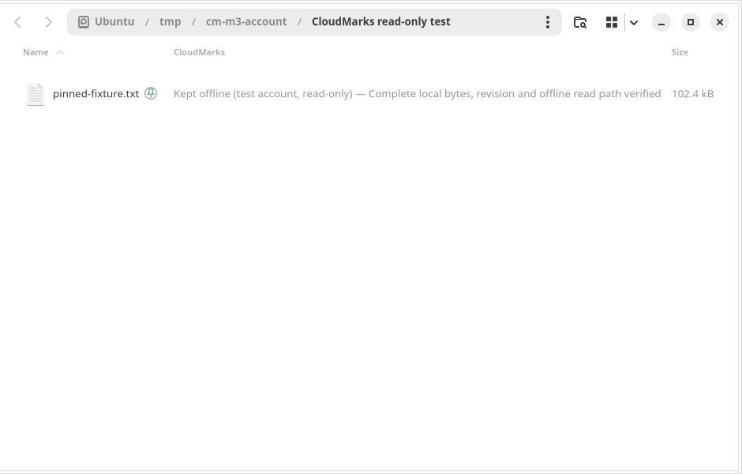

# M3 — Individual-file offline controls with M2 kept read-only

Date: 2026-10-20. Implemented as an experimental **helper/CLI workflow for the
dedicated test account**. M2 still exposes only status requests and presentation;
it has no action menus, transfer commands or writable IPC. Downloads, retry,
unpinning, recovery and local-only eviction are explicit CLI operations.
The visible file view remains read-only online and offline.

## Result

A real 102,400-byte disposable OneDrive file passed server QuickXor verification,
local SHA-256 verification, online viewing, two fresh offline mount processes,
persistent pin recovery and local eviction. Its remote item, revision and bytes
were unchanged after eviction. Modification, creation, rename and deletion
through all three mounts failed with EROFS. Controls were refused while the
experimental view was mounted. No cloud fixture was created, uploaded or deleted
by M3; it reused one of the existing M0 fixtures.

The real retained copy also reached the actual M2 adapter through its status-only
socket in an isolated Files session:



That scene uses a read-only bind of the no-network offline FUSE view into the
sandbox. The status helper runs outside the sandbox against the original view;
its scope, disk and mount evidence remain enforced. Neither the adapter nor its
independent attribute observer fetches remote metadata or content. The screenshot
contains only a disposable filename and temporary sandbox breadcrumbs.

Evidence:

- [Real account restart/eviction result](../evidence/m3/onedrive.json).
- [Real adapter result](../evidence/m3/account-desktop.json).
- [M2 desktop regression](../evidence/m3/m2-regression.json).
- [Validation record](../evidence/m3/validation.json).

The existing daily test mount/service was preserved. No daily extension/settings,
CloudMarks service, system package installation or Files restart occurred.
One verified 100 KiB pin is retained in private M3 storage for further testing;
all experimental views and helpers were stopped. Current private configuration
locations are recorded in `~/.config/cloudmarks-test/m3-work.json`.

## Controls and deliberate limits

The first workflow requires the **experimental view unmounted** before keep,
retry, unpin, free or recovery. Close its open files and stop the foreground
mount normally. The controller never changes the local tree behind a live view,
never uses a forced/lazy unmount and never operates on the existing daily mount.
Status reads may run concurrently with a CLI download through an independent
SQLite connection opened with `mode=ro`.

```bash
# All paths below are placeholders for private, verified test configuration.
python3 -m cloudmarks offline --config /private/test/offline.json init
python3 -m cloudmarks offline --config /private/test/offline.json keep document.txt
python3 -m cloudmarks offline --config /private/test/offline.json status document.txt

# Foreground experimental view; Ctrl-C requests its normal unmount.
python3 -m cloudmarks offline --config /private/test/offline.json mount
python3 -m cloudmarks offline --config /private/test/offline.json mount --offline

# After stopping that view:
python3 -m cloudmarks offline --config /private/test/offline.json unpin document.txt
python3 -m cloudmarks offline --config /private/test/offline.json free document.txt
```

`keep` persists pin intent and emits JSON byte progress. Ctrl-C cancels
cooperatively; metadata/identity checks can finish their bounded timeout before
the flag is observed. Once the short rename/commit critical section starts, it
finishes atomically or is recovered on restart. `retry` runs a new full verification/download; partial
files are never resumed or promoted as complete. `unpin` changes intent and
retains the bytes. `free` requires unpinned, idle, clean local data plus fresh
matching remote identity, revision, size and checksum. It cannot work offline.
It quarantines and verifies **private local store paths**, commits removal of
the local references, then unlinks those exact copies. It never removes the
mounted file or invokes a cloud delete/sync operation.

`mount --offline` uses a temporary **credential-free local alias** at the same
visible pathname, with no remote configured. This makes offline restart
independent of network discovery/authentication. The online view uses the
selected local-first union, with both upstreams `:ro`, ordered `epall` search,
VFS data caching off, rclone read-only policy and kernel `ro`. It verifies a
known item's effective rclone identity before exposing the online view; keep
one known file first. Fresh probe metadata is persisted, so a newer remote
revision invalidates an old copy's current-version badge. A changed checksum or
replaced identity is preserved as an error rather than refreshed as success.
There is no automatic online/offline switching.

A stale observation changes the badge to **Needs checking** even when the last
verified snapshot remains readable offline. Pin intent does not claim that a
snapshot is the current cloud revision. Cloud-only placeholders are not retained
in the initial offline view. M2's existing 8 MiB badge-verification cap and
512-entry tracking cap remain conservative: larger/over-capacity entries can
show unknown while an explicitly retained copy is readable. The CLI's explicit
verification is separate from these UI limits.

## Verification and account/root boundaries

The transport reads only explicitly configured private credentials. Every
observation verifies `/me` and the expected drive, rejects the blocked drive
through core configuration, and walks the item's parent identities back to the
allowed folder. Shared shortcuts, drive-root scope, deleted items, directories,
unsafe paths and mismatched names/ancestry are refused. It accepts Graph SHA-256,
SHA-1 or QuickXor evidence and refuses a file without a supported checksum.
QuickXor is independently checked against local rclone vectors and fixed
streaming vectors. It is a service checksum, not a cryptographic signature.

The rclone config must be the exact dedicated `origin` and read-only `view`
layout. Root IDs are deliberately normalized as `driveID#itemID`. The effective
rclone file ID and size are checked separately from Graph before content reads;
checksums and Graph identity/revision are rechecked after EOF and immediately
before visible publication. There are no upload/delete API methods or arbitrary
remote command endpoints. A 401 can refresh only the private experiment's token
copy via a read-only rclone stat; it never reconnects the daily account.
Malformed credential/configuration errors are sanitized instead of quoting lines
that might contain tokens.

The actual accessed filesystem must match the configured UUID, mount target and
writable device. The implementation distinguishes an automount trigger from its
underlying filesystem using major/minor identity; the first real test caught
this NTFS3/systemd automount case. A separate store marker and private immutable
binding tie the store to its account, root, volume, state database, case policy
and visible view. A second configuration cannot silently adopt the same tree
with another writer database or mountpoint. Configuration/credentials/state must
remain outside the managed store and view. Descendant operations use directory
FDs, refuse links and nested devices, and revalidate the store during work.

## Publication, budgets and recovery

The store contains independent immutable objects and visible-tree files; their
space is reserved together. Staging never expands a sparse placeholder with
`truncate`. Quota checks count allocated/logical bytes of all named store files,
including partials, previous snapshots and recovery candidates. Each write also
checks the physical free-space floor. The current private test budget is 256 MiB
with a 20 GiB free-space reserve; these are explicit configuration values.
Other processes can consume disk space, so ENOSPC is still handled as a failure
that preserves old completed data.

Schema 2 adds managed publication records and a durable operation journal. A
known schema-1 database upgrades transactionally after validating its binding;
unknown schema versions are refused. Downloads verify bytes and remote evidence
before publication. A complete independent visible candidate is made before
recording intent, moving the previous tree entry into recovery, and atomically
publishing with `renameat2(RENAME_NOREPLACE)`. A single SQLite transaction commits
the copy, visible path and journal completion. A failed/abrupt operation rolls
back filesystem changes from its durable intent; it never promotes pending
bytes during recovery.

```bash
python3 -m cloudmarks offline --config /private/test/offline.json recover
```

Recovery requires the expected disk and an unmounted view. If a candidate or
backup has been modified or an unexpected destination exists, recovery stops
and preserves the files. Ambiguous or superseded objects/snapshots are retained
for inspection and count against the budget. There is **no automatic orphan or
history garbage collection** in this version; do not delete arbitrary store
files to force a retry. Preserve the private state/configuration and inspect the
journal/objects before any manual repair. A space failure may therefore require
review of retained candidates, rather than eviction of the only good snapshot.

Eviction uses the same durable quarantine/rollback principle. A raw descriptor
opened deliberately against private store data retains its old bytes after an
unlink, as on Linux generally; allocated space may remain occupied until it
closes. The physical free-space floor still applies. Ordinary supported reads
use the managed FUSE view, and mutation is refused for its entire mounted
lifetime. Busy normal unmounts are reported rather than forced.

## M2 integration and setup

Core TOML remains configuration version 1. See [the core template](../../examples/config.toml),
[offline settings](../../examples/offline.json),
[transport layout](../../examples/transport.conf) and
[read-only account desktop settings](../../examples/desktop-account.json).
These contain placeholders, not usable credentials. Put actual configuration in
private user-owned directories (0700), with regular singly linked files (0600).
Create the private state directory and the selected store's parent first;
`init` refuses an existing store. Use the expected drive, blocked-personal-drive
record, and an independently verified disposable **folder ID** from the test
account. Do not use a raw Graph ID as rclone's normalized root string.

The current test configuration was prepared separately, with private backups
of the existing test configuration/service. Its token copy and mount/state/store
are independent. No new sign-in is needed while those credentials remain valid.
Do not paste credentials into chat or put live values in these templates.

Desktop settings version **2**, mode **onedrive**, point `core_config` at the
private offline JSON (rather than directly at core TOML). The helper loads the
bound core settings and opens state read-only. Version 1 fixture settings remain
supported. The socket protocol is still version 1 and accepts only `status`.
The adapter has no action menus and does no credential discovery or remote I/O.
It verifies local winner bytes and the controlled read-only mount record for a
green state; it never reads a FUSE/cloud path merely to calculate a badge.

```bash
python3 -m cloudmarks serve --settings /private/test/desktop-account.json
```

A new user deployment uses the existing reversible `install`, `enable`,
`disable` and `uninstall` tools; installation starts disabled. An older M2
snapshot must be uninstalled/reinstalled to load the new account settings/schema
support. The user-only snapshot's existing installation path remains stable.
No service is enabled and no Files process is restarted automatically. Prefer
an isolated session for the first real test. Native application/thumbnail reads
can still stream cloud-only files through an online rclone mount; the adapter
itself initiates no hydration. The isolated tests disable thumbnails.

## Reproduction and remaining scope

```bash
python3 -m unittest discover -s tests -v

# Opt-in real test: explicit private config + one existing disposable file.
python3 tests/integration/run_offline.py \
  --config /private/test/offline.json --path document.txt \
  --result /private/test/result.public.json

# Same test against an already initialized, correctly bound private test store:
# add --reuse-owned-store (does not bypass any scope/disk/binding checks).

# Actual read-only adapter, private helper and offline mount in isolated Files:
python3 tests/desktop/run_account_readonly.py \
  --config /private/test/offline.json --path document.txt \
  --sysroot /tmp/cloudmarks-m0/sysroot --work /tmp/cm-account-review
```

The account desktop scene currently expects a root-level disposable filename;
the controller/integration runner also support safe nested relative paths.
The scene leaves its explicit pin retained, removes only its user deployment,
and normally unmounts its own view. M2's separate rendering/regression harness
continues to cover eight appearances/zooms/views, 2,000 entries, helper failure
and recovery, disable and uninstall.

Physical network disconnection, disk unplug/replug, logout/login, larger real
files and user readability/accessibility review remain operational integration
checks before daily use. Offline tests configure no origin; the host stays
online. Unit tests inject cancellation, disk-full, missing disk, concurrent
revision changes, link tampering and abrupt process death at publication and
eviction boundaries. No destructive full-disk test was run.

At the M3 checkpoint, recursive coverage and remote change tracking were
deferred. [M4](m4-change-tracking.md) now adds explicit stable-ID checks, durable
jobs, preserved conflict snapshots and bounded folder manifests. Hot mounted-tree
updates, editing, uploads and two-way synchronization remain deferred. M5 still
needs CI, release/installation polish, a license choice and a release decision. These are experimental individual-file controls,
not a production Windows Files On-Demand replacement.

Primary API references: [Graph item metadata](https://learn.microsoft.com/en-us/graph/api/driveitem-get?view=graph-rest-1.0),
[QuickXor definition](https://learn.microsoft.com/en-us/onedrive/developer/code-snippets/quickxorhash?view=odsp-graph-online),
[rclone union](https://rclone.org/union/), [rclone cat](https://rclone.org/commands/rclone_cat/).
